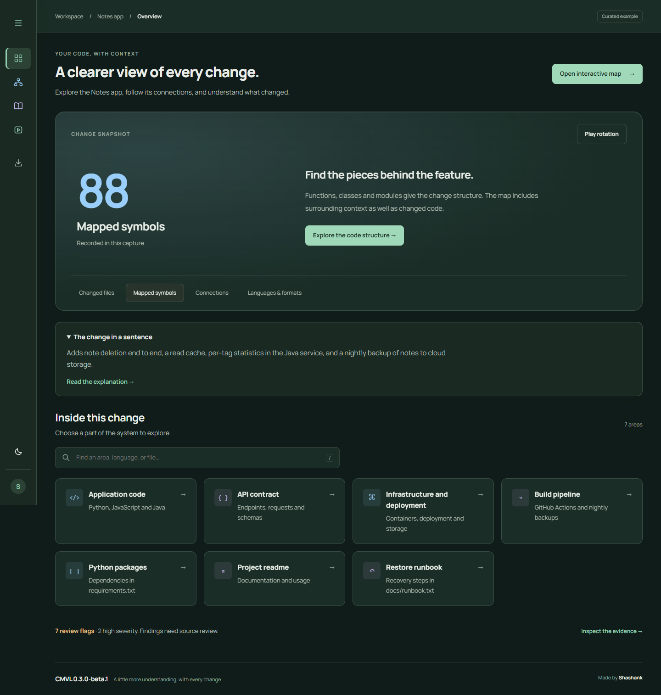
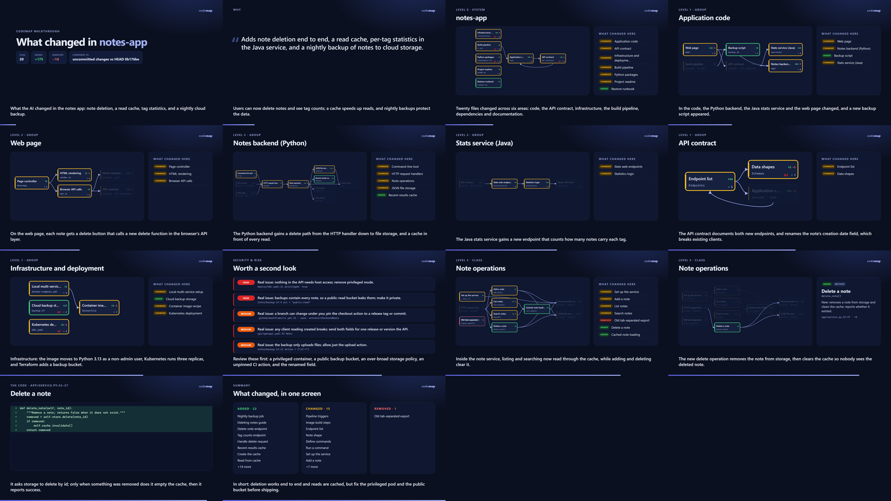
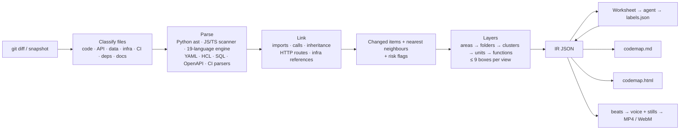

# CMVL: understand the code your AI wrote

> **Beta 0.3.0-beta.1.** A product by VibeGuru Services Pvt. Ltd. Built by Shashank.
> The `codemap` engine uses Python's standard library. Maps and dashboards work offline.
> Works as an agent skill for Claude Code, OpenAI Codex, Gemini CLI, Cursor, GitHub Copilot and other agents that read `SKILL.md`.

Get the tagged beta from [GitHub Releases](https://github.com/Shashank-Singh03/CMVL-a-product-by-vibeguru-services-pvt-ltd-/releases).
Download the `CMVL-0.3.0-beta.1.zip` asset, extract it, and run `python install.py` to install the skill.
Python 3.9+ and Git are required for the core workflow; video adds a browser and ffmpeg.
The [update guide](docs/updates.md) explains how dashboard versions reach users;
[release instructions](docs/releases.md) cover publishing the next beta.

Everyone using the same release gets the same bundled dashboard UI. Project data,
available outputs, theme, and learning progress are local to each user. Saved HTML
keeps the version that generated it until it is regenerated. New releases do not
silently replace installed skills or old walkthroughs.

AI agents now write code faster than people can read it, and it is tempting to stop reading at all.
codemap turns a codebase, or just the changes an agent made, into **layered, human-sized maps**:

- **The system at the top**, then areas (code, API contracts, infrastructure, CI, dependencies), then folders, classes and functions.
- **At most 9 boxes per view**, so each view fits in working memory.
- **Each view reads like a workflow**: callers come before callees, and unchanged neighbours are dimmed for context.
- **Changes across the stack**: supported programming languages, API contracts, Docker/Kubernetes/Terraform,
  CI pipelines, databases, dependencies and docs. Other changed text files remain visible for the agent to describe.
- **Risk flags**: about 50 deterministic security and reliability checks on the changed lines (secrets, public buckets,
  privileged containers, IAM wildcards, removed auth checks, breaking API changes and more).
- **A narrated video with real audio** that walks through what changed, layer by layer.

The initial structural pass (parsing, linking, layering, risk checks, diagrams, video) is deterministic and costs **zero LLM tokens**.
Your existing agent can then inspect source and correct missing or wrong graph relationships using a source-backed review,
before adding plain-English names, summaries and narration. No separate model API key is required.



## Try it in 30 seconds

```bash
python skills/codemap/scripts/codemap.py demo                      # sample product + a simulated AI change, mapped for 0 tokens
python skills/codemap/scripts/codemap.py demo --labeled --video    # with AI-style labels and a narrated video
```

The demo builds a small "notes" product in git: a Python API, a JavaScript web page, a Java stats service, an OpenAPI
contract, a Dockerfile, Docker Compose, Kubernetes, Terraform and a GitHub Actions pipeline. It then makes the kind of change
an agent would, across 20 files: note deletion end to end, a read cache, per-tag statistics in Java and a nightly cloud
backup, including some risky choices (a privileged pod, a public bucket, a wildcard IAM policy, an unpinned CI action
and a renamed API field). Open the printed `codemap.html` and press **Watch walkthrough**.

To skip running anything, open the pre-made results in [examples/demo-output/](examples/demo-output/):
`codemap.html` (with the recorded narration built in), `codemap.md`, the 2-minute `codemap.mp4` and `codemap.webm`,
plus the `worksheet.md` the agent saw and the `labels.json` it wrote.

Start at the [Notes app overview](examples/demo-output/index.html) for connected entry points into the example.
The dashboard and map now have Back/Home navigation, bookmarkable lessons, and contextual links between changes,
maps and analysis. Evidence and definitions expand when needed; see the [navigation guide](docs/navigation.md).

## What you get

| Output | What it is | Needs |
|---|---|---|
| `.codemap/codemap.html` | Clickable explorer. Zoom from system to area to class to function, see each function's diff, the workflow order and the risk flags, and watch the narrated walkthrough. | Any browser |
| `.codemap/codemap.md` | The same map as Markdown with Mermaid diagrams and a risk table (renders on GitHub). | Nothing |
| `.codemap/codemap.diff` | All collected changed text lines, beyond the diagram's capped excerpts. Recognized credentials are redacted; this is a review artifact, not an apply-ready patch. | Diff mode |
| `.codemap/codemap.mp4` | A narrated 1080p video: H.264 with loud, clear 48 kHz stereo AAC audio. | ffmpeg and Chrome, Edge or Chromium (`codemap doctor` checks) |
| `.codemap/codemap.webm` | The same video as VP8 + Opus (`--webm`). Plays **with sound** inside VS Code. | as above |

Open the HTML in its original local folder to use **Open in VS Code** at a recorded source line. Hosted or relocated
maps may not have working source links. Keep `codemap.diff` beside a change map to review all collected changed lines.



### About the sound

- **In VS Code**, the built-in media preview plays MP4 video but not its AAC audio, because VS Code ships without that
  codec. Add `--webm` and open `codemap.webm`, or open the MP4 in a browser or media player. codemap prints this tip
  when it runs inside VS Code's terminal.
- **In the HTML page**, after `codemap video` the walkthrough plays the recorded narration (small MP3 clips embedded in
  the file). Before that it uses the browser's own speech voices.
- **Voices**: with `pip install piper-tts`, codemap uses the Piper neural voice (natural-sounding, offline). Its default
  voice, `en_US-ljspeech-medium`, was trained on public-domain recordings. Otherwise it uses the OS voice
  (Windows SAPI, macOS `say`, Linux `espeak-ng`), or any program you pass with `--tts "cmd:..."`.

## What it understands

| Area | Files | Becomes boxes for |
|---|---|---|
| Code | Python, JavaScript/TypeScript (+ Vue, Svelte, Astro), Java, Kotlin, Scala, Groovy, C#, Go, Rust, C, C++, PHP, Swift, Dart, Ruby, Lua, Elixir, R, Solidity, shell, PowerShell | classes, functions, methods |
| API contracts | OpenAPI/Swagger, GraphQL, Protobuf | endpoints, schemas, RPCs |
| Data & schema | SQL, Prisma | tables, columns, migrations |
| Infrastructure & cloud | Dockerfile, Docker Compose, Kubernetes (+ Helm templates), Terraform, Bicep, CloudFormation/SAM | stages, services, workloads, resources |
| CI/CD & build | GitHub Actions, GitLab CI, Azure Pipelines, CircleCI, Bitbucket, Jenkinsfile, Makefile | triggers, jobs, targets |
| Dependencies | npm, pip, pyproject, Go modules, Cargo, Maven, Gradle, Gemfile, Composer, NuGet | packages |
| AI, config, docs | Jupyter notebooks, prompt files, `.env`/YAML/JSON/TOML settings (recognized credentials are redacted), Markdown | sections, keys |
| Anything else | any other changed text file | one box, described by the agent from its changed lines |

Arrows cross languages and areas: the browser's `fetch("/notes/1", DELETE)` links to the OpenAPI operation and to the
Python or Java handler that serves it; a Compose service links to its Dockerfile; a Kubernetes Service to the Deployment
it selects; a CI job to the script it runs; a Terraform output to the resource it reads.

## Use it inside your AI agent

1. Install the skill:
   ```bash
   python install.py                          # user-wide: ~/.claude/skills and ~/.agents/skills
   python install.py --project path/to/repo   # or for one project only
   python install.py --agents claude,gemini   # choose targets: claude, agents, gemini, cursor, copilot
   ```
   `~/.agents/skills` is the shared folder that OpenAI Codex, Gemini CLI, Cursor, GitHub Copilot and others read.
   Claude Code reads `~/.claude/skills`.
2. Restart the agent and ask, for example:
   - "explain what you just changed"
   - "is this change safe to ship?"
   - "map this repo"
   - "make a video of this branch vs main"

The agent then:
1. Runs `codemap analyze --review`.
2. Reads relevant source, proposes source-backed graph corrections in `review.json`, then runs `codemap review`.
3. Fills in the regenerated labeling worksheet, then runs `codemap render` (and `codemap video` if requested).
4. Replies with the links, review coverage, unresolved issues and a concise explanation.

Source review uses additional model tokens according to the inspected scope; the script itself makes no model API calls.

**Tip:** ask the agent to run `codemap mark` at the start of a task. A later `analyze` then explains exactly what changed during that
session. This works even outside git.

## Automatic walkthroughs in Claude Code (opt-in)

Install project-scoped hooks if you want a walkthrough after coding tasks:

```bash
python install.py --agents claude --auto --project path/to/repo
python skills/codemap/scripts/codemap.py auto on path/to/repo
```

Restart Claude Code in that project. A prompt records a private before snapshot; Stop freezes the end sources and
continues the **same Claude conversation** to review the graph, explain the changes and supply narration. Parsing,
review validation, rendering and video run as supervised local background stages. Video is on by default; a no-change
task is skipped. Open `.codemap/index.html` for task maps, status and finished video links. If video fails, the map is
retained; run `doctor`, then `task retry --id <task-id> --stage video`.

The local React dashboard has search, status filters, task details, stage progress and video previews, with light
and dark themes. **Learning** walks through the goal, vocabulary, highlighted changes, connections and review
questions using selected redacted excerpts from the saved analysis. Definitions follow the observed code, DevOps,
CI/CD, API and data formats. Its manual reading checklist is browser-local and separate from generation progress
or source-review coverage; it does not verify understanding. **Analysis** provides four bundled Apache ECharts
views with data tables for languages/formats, system areas, added/removed lines and task statuses. File counts can
repeat across saved tasks and do not measure accuracy or whole-project completion.

The dashboard runs from the generated HTML without Node, a CDN or a separate backend, including through
Live Server. Update an existing skill installation, then regenerate its history with
`python skills/codemap/scripts/codemap.py task history path/to/repo --open`. HTTP pages refresh public task
metadata while jobs are active; opening the file directly uses the Refresh button to reload. **Compare** puts two
captures side by side and exports their recorded summaries. To enable retry/cancel buttons and project settings,
run `python skills/codemap/scripts/codemap.py serve path/to/repo --open`. See the
[local control center](docs/control-center.md) and [dashboard build guide](dashboard/README.md).

There is no additional model API or new key, but the continuation uses normal Claude tokens. Captures describe a
time window, not an atomic snapshot or verified authorship; overlaps and omitted unchanged binary/oversized files
are disclosed. Task source copies under `.codemap/tasks/<id>/work` and `output/baseline` retain raw source and must
stay private. Model review can be partial and is not proof of semantic correctness.
Serving the whole project with a static server can expose those raw snapshots by URL; the dashboard's filtered
links are not access control. Share only inspected output artifacts.

Manual installation and commands remain unchanged. To opt a project out, run
`python skills/codemap/scripts/codemap.py auto off path/to/repo`; use `install.py --no-auto` with the same install scope
to remove codemap's hooks while preserving the skill and unrelated Claude settings. Native no-change and two-task
review-to-video checks passed on a small Windows fixture with Claude Code 2.1.71. Normal Claude permissions apply;
the check used invocation-specific approvals. Other versions, platforms and large workflows remain unvalidated.

See [automatic mode](docs/automatic.md) for configuration, task-specific review paths, cancellation, retries, privacy,
settings backups and uninstall instructions. Automatic hooks currently target Claude Code only.

## Use it from the command line

```bash
CM="python skills/codemap/scripts/codemap.py"
$CM analyze                     # uncommitted changes (or the last commit if the tree is clean)
$CM analyze --base main         # this branch vs main
$CM analyze --repo              # the whole repository
$CM analyze --repo --review     # also ask your existing agent to verify structure against source
$CM review                      # validate review.json and regenerate the map/label worksheet
$CM analyze --repo --audit      # ... and scan eligible text files, including config and docs
$CM analyze src/payments        # just one folder
$CM analyze --tier full         # also write a worksheet for an AI agent to name the chunks
$CM render                      # merge .codemap/labels.json into the outputs
$CM video --webm                # narrated MP4 + a WebM that plays with sound in VS Code
$CM video --tts piper           # natural neural voice (pip install piper-tts first)
$CM mark                        # remember "now"; later analyses explain only newer edits
$CM doctor                      # what can this machine do?
```

All options are listed in [skills/codemap/references/options.md](skills/codemap/references/options.md).

## Risk flags

Every analysis checks the added and removed lines (and, with `--audit`, whole files) against about 50 rules, and
checks API and database changes structurally (a removed endpoint or field, a changed field type). Each flag says what
was found, where, and why it matters, in plain words. Recognized credential values are replaced with `[REDACTED]` in
maps, worksheets, labels, caches and narration. Detection is pattern-based; unusual secret formats can be missed.
Local `mark` baselines retain original source for accurate comparisons and should stay private.

The flags are hints for a reviewer, not verdicts. With a worksheet, the agent confirms each one ("Real issue: ...")
or calls it a false positive, and the walkthrough has a "Worth a second look" scene.
Precision was tuned on real projects: an `--audit` of spring-petclinic, spf13/cobra, terraform-aws-modules/vpc and
dotnet/eShop (688 mapped files) now raises 6 flags, each a real pattern (wildcard IAM actions, `pull_request_target`,
a literal client secret in sample code). Before tuning it raised 87, mostly harmless network routes and comments.

## How it keeps tokens low

| Tier | What the agent is asked to write | Demo change (20 files, +175/−14) |
|---|---|---:|
| `free` | nothing (names come from code, docstrings and config) | **0** |
| `lite` | names for unclear chunks only | 2.4k (53 items) |
| `full` | every chunk, the "why" and a verdict per risk flag | 5.0k (83 items) |
| `video` | full + one narration line per scene | 5.1k |

Whole-repository maps, at the default budgets:

| Repository | Source | `lite` | `full` |
|---|---:|---:|---:|
| CPython `asyncio` (Python, 33 files) | ≈145k | 3.6k | 8.6k |
| zod `src/` (TypeScript, 134 files) | ≈373k | 3.5k | 8.6k |
| spring-petclinic (Java, SQL, Kubernetes, CI; 45 files) | ≈29k | 3.5k | 8.5k |
| terraform-aws-vpc (Terraform, CI; 82 files) | ≈130k | 3.6k | 8.6k |

These are measured worksheet sizes (the agent's input), at about 3.6 characters per token. For the demo, the agent's
reply was about 3.5k tokens. Be aware that for a small change the worksheet is about the size of the diff itself (≈3.4k
tokens here): the value there is the layered structure and the explanations, not a saving. For whole repositories the
worksheet is 4–100× smaller than the source and stays bounded by the budget.

Four things keep the numbers small:
- **Signatures, not whole files.** The worksheet holds signatures, docstrings and only the changed lines.
- **Highest value first.** It is filled in priority order and stops at a token budget.
- **Cached labels.** Labels are stored by content hash, so a re-run only asks about code that changed.
- **No extra explaining.** If the agent that made the change runs the skill, it already knows *why*.

Full details are in [docs/tokens.md](docs/tokens.md).

## The video

The agent never writes video code. A walkthrough is a list of beats; each beat pairs one spoken sentence with a fixed
scene template (title card, a layer with boxes highlighted, the risk list, a code diff, or a summary).
1. A voice speaks each line (Piper, the OS voice, or your own command).
2. Headless Chrome or Edge renders each scene to a 1920×1080 still.
3. ffmpeg holds each still for exactly as long as its narration, with loudness-normalized audio.

Measured on a Windows laptop (no GPU) for the demo's 118-second walkthrough (14 beats, 1080p):

| Step | Piper voice | OS voice (SAPI) |
|---|---:|---:|
| Narration, plus the MP3 clips for the HTML page | 7.4 s | 1.6 s |
| Frames (14 stills) | 10.0 s | 10.9 s |
| Encode MP4 | 4.8 s | 5.8 s |
| WebM (`--webm`) | 3.9 s | – |
| **First render** | **25.4 s** | **17.9 s** |
| Re-render, nothing changed | 0.2 s | 0.2 s |
| Re-render, one sentence edited | 12.7 s | – |

Timings vary with machine load: the same render took about twice as long while other jobs were running.

More in [docs/video.md](docs/video.md).

## How it works



See [docs/architecture.md](docs/architecture.md) for the algorithms and design decisions.

## Status and limitations (honest draft notes)

- **Parsing outside Python and JS/TS is pattern-based.** Python is parsed exactly with `ast`, and JavaScript/TypeScript with a
  fast scanner. The other 19 languages share one engine that blanks comments and strings, then finds classes, functions,
  methods, imports and calls by language-specific patterns and brace or `end` matching. It has zero parse errors on
  real Java (spring-petclinic), Go (cobra), C# (eShop) and Terraform (terraform-aws-vpc) code, but it is not a compiler:
  macros, unusual generics and code generated at build time can be missed.
- **Call resolution is heuristic.** It follows imports, packages and namespaces, `this`/`self`, field types and constructor
  injection, but misses dynamic dispatch, dependency-injection containers and event buses, so DI-heavy C# or Java shows
  fewer links (eShop: 1,579 symbols, 793 links). Low-confidence links are drawn dashed. Optional model proposals require
  matching source evidence and remain marked as model inferences; validation does not prove semantic correctness.
- **Config parsers read the common shapes.** Heavily templated Helm charts and unusual pipeline syntax are approximated.
- **Risk flags are line-based heuristics.** They catch common mistakes, not logic bugs, and they are not a replacement for
  a security scanner.
- **Native video and speech testing covers Windows 11**, with Python 3.12 and 3.13, Chrome 155 and Edge, ffmpeg 9.0.2 and
  Piper 1.8. Hosted core regression checks target Python 3.9/3.13 on Windows and Linux; see
  [Actions](https://github.com/Shashank-Singh03/CMVL-a-product-by-vibeguru-services-pvt-ltd-/actions) for results.
  Native macOS/Linux speech and browser combinations are not yet certified.
- **Piper is installed separately** (`pip install piper-tts`, about 6 s for 2 minutes of speech on a laptop CPU) and is
  licensed GPL-3.0; codemap only runs it as a separate program, and falls back to the OS voice without it.
- **Very large codebases** map fine: the whole Python standard library (636 files, 17k symbols) takes 6.4 s, and 12.5 s with
  `--audit`. But their top level is less meaningful, so scope them with a folder path or `--base`.

## Project layout

```
README.md               this file
CHANGELOG.md            what changed in each version
install.py              installs the skill into agents' skill folders
skills/codemap/         the skill itself (this folder is what gets installed)
  SKILL.md              agent instructions (~1.1k tokens)
  references/options.md loaded by the agent only when needed
  scripts/codemap.py    CLI entry point
  scripts/codemap_lib/  the pipeline (standard library only)
  assets/viewer.html    HTML explorer, walkthrough player and video scene renderer
  assets/demo-labels.json  sample agent output used by `demo --labeled`
docs/                   architecture, tokens, video, data formats, research, roadmap
examples/demo-output/   ready-made outputs from `demo --labeled --video --webm`
tests/test_codemap.py   unit and end-to-end tests
```

## Development

```bash
python -m unittest discover -s tests -v                     # core and regression tests
CODEMAP_TEST_VIDEO=1 python -m unittest discover -s tests   # also renders real MP4 and WebM files with audio
```

Viewer interaction regressions use Node when available. They check navigation, search and playback state;
real-browser layout and platform speech behavior still require manual verification.

Measure against reviewed fixture expectations and real Python declaration references:

```bash
python benchmarks/run_accuracy.py --stdlib --project .
python benchmarks/run_accuracy.py --baseline benchmarks/baseline.json --fail-on-regression
```

The runner writes a local accuracy report under `benchmarks/results/`, separating authored fixtures from
real-source samples and showing known misses. Generated reports and private evaluation runs are intentionally
excluded from this repository. They do not estimate accuracy across arbitrary codebases.
See [benchmark methodology](benchmarks/README.md) and the [beta validation scope](docs/beta-validation.md).

## Documentation

- [docs/architecture.md](docs/architecture.md): the pipeline, parsers, linking, layering, risk lens and design decisions
- [docs/model-review.md](docs/model-review.md): source-backed model corrections, uncertainty, validation and limits
- [docs/automatic.md](docs/automatic.md): opt-in Claude task hooks, private captures, background walkthroughs and recovery
- [docs/tokens.md](docs/tokens.md): token budget, tiers, caching and cost estimates
- [docs/video.md](docs/video.md): the video pipeline, audio, voices, timings and options
- [docs/ir-schema.md](docs/ir-schema.md): data formats (IR, worksheet, `labels.json`, cache)
- [docs/research.md](docs/research.md): the feasibility research behind the design
- [docs/roadmap.md](docs/roadmap.md): what comes next
- [CHANGELOG.md](CHANGELOG.md): what changed in each version
- [docs/updates.md](docs/updates.md): release versions, installation updates, and refreshing saved dashboards
- [docs/browser-testing.md](docs/browser-testing.md): portable optional browser acceptance setup

## Licensing

A project-wide open-source license has not been selected for this beta. Third-party
components retain their own license terms and notices, including the bundled React,
Apache ECharts, and Manrope assets. See the notices included with those assets.
