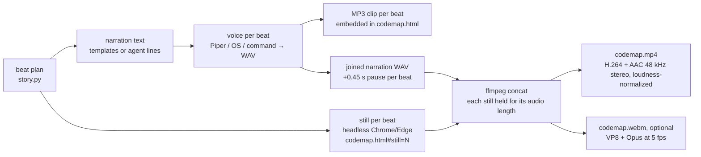
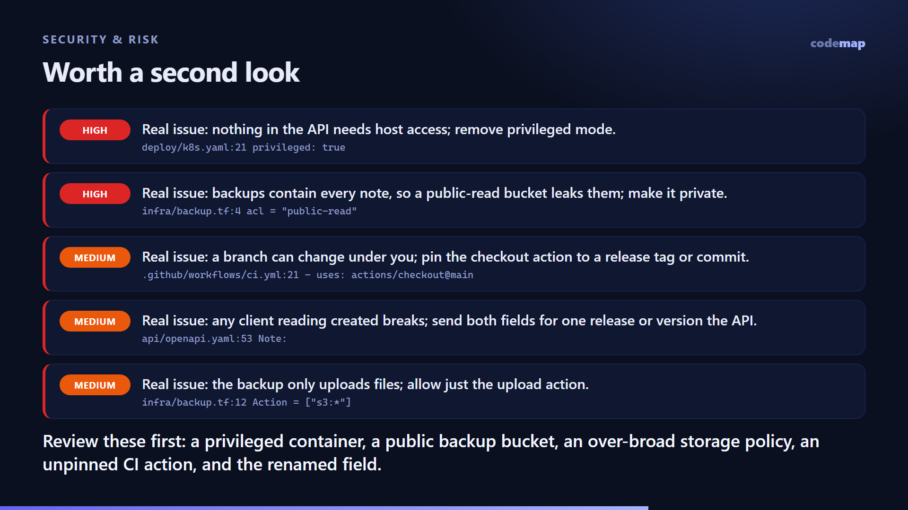

# The video walkthrough

The video is meant for people who would rather watch than read: a narrated tour of "what the AI changed and why",
layer by layer. Two design rules keep it cheap and fast:

1. **The LLM never writes video code.** It writes at most one sentence per scene. Layout, highlighting, code panels
   and timing all come from fixed templates.
2. **Scenes are stills.** An explainer is mostly a picture held while someone talks, so each scene is rendered once as
   a 1920×1080 image and held for exactly as long as its narration. That makes the video about as fast to produce as
   taking screenshots, and it makes scenes easy to cache.

## Three ways to watch

| | In the browser (`codemap.html` → Watch walkthrough) | MP4 (`codemap video`) | WebM (`codemap video --webm`) |
|---|---|---|---|
| Needs | Any modern browser | ffmpeg and Chrome, Edge or Chromium | the same |
| Voice | The recorded narration once `codemap video` has run; the browser's own voices before that | Piper, the OS voice, or your command | the same audio |
| Plays with sound in | every browser | browsers, media players, phones, Slack, GitHub | browsers, media players, **VS Code** |
| Motion | Fade and rise transitions; highlights animate between beats | Static scenes, cut on beat boundaries | the same |

## Where the sound is, and why VS Code was silent

The MP4 always had a narration track. Two things made it hard to hear:

- **VS Code's built-in media preview plays MP4 video but not AAC audio**, because VS Code ships without the AAC codec.
  Opening `codemap.mp4` inside VS Code therefore shows a silent video. This is a known limitation, documented for
  example in [Remotion's troubleshooting guide](https://www.remotion.dev/docs/troubleshooting/video-has-no-sound) and
  visible in VS Code's [media preview extension](https://github.com/microsoft/vscode/tree/main/extensions/media-preview).
- **The first draft's audio was quiet and thin**: 22 kHz mono straight from the OS voice, around −21 dB.

What v0.2 does about it:

| Change | Effect |
|---|---|
| Loudness normalization (EBU R128, −16 LUFS, true peak −1.5 dB) | Speech is as loud as typical online video on every device |
| 48 kHz stereo AAC at 192 kbps | The standard format phones, browsers and players expect |
| `--webm` writes a VP8 + Opus copy | Plays with sound in VS Code, whose player accepts WebM only with VP8 video (and in every browser) |
| Narration embedded in `codemap.html` as MP3 clips | The in-browser walkthrough speaks with the recorded voice, even where the browser has no speech voices |
| A tip in the output when run from VS Code's terminal | "VS Code's built-in player mutes AAC audio; open the MP4 in a browser or media player, or add --webm" |
| Piper neural voice | Natural speech instead of a robotic desktop voice |

Measured on the demo: the MP4 and the WebM both carry 48 kHz stereo audio with a mean level of about −20.5 dB including
the pauses between sentences, and peaks between −3 and −1.7 dB.

## Voices (`--tts`)

| Value | Voice | Notes |
|---|---|---|
| `auto` (default) | Piper if it is installed and its voice is downloaded, otherwise the OS voice | |
| `piper` | [Piper](https://github.com/OHF-Voice/piper1-gpl) neural TTS, offline | `pip install piper-tts`. The voice model (~63 MB) downloads once to `~/.cache/codemap/piper`. Piper is GPL-3.0 and installed separately; codemap only runs it as a separate program. |
| `os` | Windows SAPI, macOS `say`, Linux `espeak-ng` | Present on every OS and instant, but robotic |
| `cmd:<command>` | Any program | `{text}` becomes a UTF-8 text file, `{out}` the WAV to write. Example: `--tts "cmd:my-tts --in {text} --out {out}"` |
| `none` | Silent | Captions stay on screen |

`--voice` picks a Piper voice (for example `en_US-amy-medium`) or a system voice (for example `"Microsoft Zira Desktop"`).
The default Piper voice, `en_US-ljspeech-medium`, was trained on the [LJ Speech](https://keithito.com/LJ-Speech-Dataset/)
dataset, which is in the public domain. If you pick another Piper voice, check its model card: some, including the
popular `lessac` voices, were trained on data licensed for research only.

## Pipeline



1. **Beat plan.** Deterministic and built from the map.
   - **Diff mode:** a title card, then "why", the top-level overview, a tour of each changed area, a "Worth a second look"
     scene when there are risk flags, deep dives into the largest changes (the class view, its most-changed function,
     and that function's code), and a summary.
   - **Repo mode:** a tour of the top level and its most important parts.
   - `--minutes` sets the target length (default 2).
2. **Narration.** Template sentences built from labels, such as "Zooming into Note Service: list notes and search changed;
   delete note was added." With `--tier video`, the agent can replace any line through `labels.json` → `beats`.
3. **Voice.** Piper synthesizes all lines in one process; on Windows the OS voice runs all lines through one PowerShell
   process, elsewhere `say` / `espeak-ng` run per line. Each beat's measured length plus a 0.45 s pause sets its scene
   length, so audio and pictures can't drift apart.
4. **Stills.** Each beat opens `codemap.html#still=N` in a headless browser with its own temporary profile, so it never
   touches the user's running browser. The page renders that scene at exactly 1920×1080. Four browser processes run in parallel.
5. **Encode.** One ffmpeg pass using the concat demuxer for images: H.264 at 15 fps (`-tune stillimage`), the
   loudness-normalized AAC track, and `+faststart`. With `--webm`, a second pass from the same stills and
   narration writes VP8 + Opus at 5 fps (scenes are stills, so 5 fps looks the same).

## Caching

- **Audio** is cached by engine, voice, rate and text, and so are the MP3 clips for the HTML page.
- **Stills** are cached by a hash of everything the scene shows: the beat, its view, the nodes it references, the
  scope, the risk list for the risk scene, and the template version.
- **The encode** is skipped when the frame list and audio clips are unchanged.

Editing one narration line therefore re-records one clip, re-renders one frame and re-encodes. Cached files live in
`.codemap/video/`. Because the map itself is deterministic, the same change always hits the same cache entries.

## Measured timings

Windows 11 laptop, no GPU, Chrome 155, ffmpeg 9.0.2, Piper 1.8. Demo walkthrough: 14 beats, 118 s of narration, 1080p.

| Run | Voice | Frames | Encode MP4 | WebM | Total |
|---|---:|---:|---:|---:|---:|
| First render, Piper | 7.4 s | 10.0 s | 4.8 s | 3.9 s | 25.4 s |
| First render, OS voice (SAPI) | 1.6 s | 10.9 s | 5.8 s | – | 17.9 s |
| Re-render, nothing changed | 0 s | 0 s | skipped | skipped | 0.2 s |
| Re-render, one narration line edited (Piper) | 3.5 s | 1.0 s | 4.4 s | 3.8 s | 12.7 s |

The voice column includes the MP3 clips for the HTML page. Piper alone takes about 6 s for the 2 minutes of speech
(about 20× faster than real time on this laptop's CPU). Timings vary with machine load: the same first render took
about twice as long while other jobs were running. For a quick draft, `--res 720 --tts none` skips the voice entirely.

For scale, the research benchmark on the same machine (2-minute 1080p scene) measured Remotion at 110 s, HyperFrames
at 171 s, a custom Chromium capture loop at 86 s and Manim at about 630 s; see [research.md](research.md).
Those numbers are for continuous animation. codemap avoids most of that work by holding stills.

## Options

```bash
codemap video                      # 1080p, Piper if installed, else the OS voice
codemap video --webm               # also codemap.webm, which plays with sound in VS Code
codemap video --tts piper          # natural voice (pip install piper-tts; the voice downloads once)
codemap video --tts piper --voice en_US-amy-medium
codemap video --tts os --voice "Microsoft Zira Desktop" --rate 1
codemap video --res 720            # faster, smaller
codemap video --tts none           # silent, with captions on screen
codemap video --fps 30             # if a platform insists on 30 fps
codemap video --jobs 2             # fewer parallel browsers on low-memory machines
codemap doctor                     # shows which of browser / ffmpeg / voices / Piper are available
```

Environment overrides: `CODEMAP_BROWSER`, `CODEMAP_FFMPEG`, `CODEMAP_PIPER_PYTHON` (a Python that has `piper-tts`) and
`CODEMAP_PIPER_DIR` (where voices are stored). If ffmpeg is not on PATH, codemap also finds the binary shipped by
`pip install imageio-ffmpeg`.

## Scene anatomy (1920×1080)



- **Header:** the level ("Level 1 · group") or scene type ("Security & risk") and the title.
- **Left:** the layer diagram. The focused boxes are lit and the rest dimmed; edges into the focus are highlighted.
  Boxes with risk flags carry a ⚠ badge.
- **Right:** a card for the focused item (status, title, identifier, summary, location and line counts), or the list of
  changes in this view.
- **Risk scene:** the flags by severity, each with its location, the offending line (secrets masked) and the agent's note.
- **Bottom:** the narration as a caption, so the video works on mute, plus a progress bar.

## Choices and alternatives

| Option | Why it is or isn't the default |
|---|---|
| Piper (default when installed) | Natural, offline, fast enough; GPL-3.0, so it stays a separate, optional install |
| OS voices (fallback) | Present on every OS, instant, free. They sound robotic. |
| Browser voices (HTML player, before a video export) | Free and often natural (Edge's "Natural" voices), but they can't be recorded into the MP4 |
| Kokoro-82M (roadmap) | Best free local quality, Apache-2.0, but a 326 MB model. Planned as an opt-in `--tts kokoro`. |
| OpenAI / ElevenLabs TTS | About $0.015–0.07 per minute; needs an API key. Possible opt-in. |
| edge-tts | Unofficial client for Microsoft's online service with unclear terms. Not used. |
| Remotion | Excellent, but companies with more than 3 people need a paid license, so it is the wrong default for a free tool. |
| Animated transitions | Planned as segment-level animation for changed beats only, keeping the cache. |
