# codemap: notes-app

> Changes: uncommitted changes vs HEAD bd14188 · 20 files · +175 −14  
> Generated 2026-10-23 01:56 by codemap 0.2.0 · tier `video`. Each diagram shows at most 9 boxes; arrows mean *calls / uses*.

[Open the full unified diff](codemap.diff) (recognized credentials redacted). For review only; not an apply-ready patch. Keep `codemap.diff` beside this map when sharing or moving it.

## Why

Adds note deletion end to end, a read cache, per-tag statistics in the Java service, and a nightly backup of notes to cloud storage.

## What changed

| | count | where |
|---|---:|---|
| **added** | 22 | `backup`, `Deleting notes`, `Endpoints.DELETE /notes/{id}`, `Endpoints.GET /stats/tags`, `NotesAPI.delete`, `LRUCache`, `LRUCache.__init__`, `LRUCache.get`, `LRUCache.put`, `LRUCache.invalidate`, `NoteService.delete_note`, `NoteService._all_notes` +10 more |
| **changed** | 15 | `on`, `container image`, `Endpoints`, `Schemas.Note`, `build_parser`, `main`, `NoteService.__init__`, `NoteService.add_note`, `NoteService.list_notes`, `NoteService.search`, `JsonStore.save`, `Deployment/notes-api` +3 more |
| **removed** | 1 | `NoteService.legacy_export` |

## Risk flags

Deterministic checks on the changed lines. Hints for a reviewer, not verdicts.

| severity | where | what | note |
|---|---|---|---|
| 🔴 high | `deploy/k8s.yaml:21` | Runs a container privileged, with full access to the host. | Real issue: nothing in the API needs host access; remove privileged mode. |
| 🔴 high | `infra/backup.tf:4` | Makes storage publicly readable on the internet. | Real issue: backups contain every note, so a public-read bucket leaks them; make it private. |
| 🟠 medium | `.github/workflows/ci.yml:21` | A third-party action is pinned to a moving branch, not a version or commit. | Real issue: a branch can change under you; pin the checkout action to a release tag or commit. |
| 🟠 medium | `api/openapi.yaml:53` | Field 'created' was removed from Note; clients that read it will break. | Real issue: any client reading created breaks; send both fields for one release or version the API. |
| 🟠 medium | `infra/backup.tf:12` | Grants every action of a cloud service (for example "s3:*"). | Real issue: the backup only uploads files; allow just the upload action. |
| 🟡 low | `infra/backup.tf:13` | Applies a permission to every resource (Resource: "*"). | Real issue: limit the policy to the backup bucket instead of every resource. |
| 🟡 low | `requirements.txt:2` | New dependency boto3: check its license, maintenance and size. | Probably unneeded: the backup script uses the AWS command-line tool, not this library. |

## Map (read top-down)

### Level 0 · notes-app

*One change touched code, the API contract, infrastructure, the pipeline, dependencies and docs.*

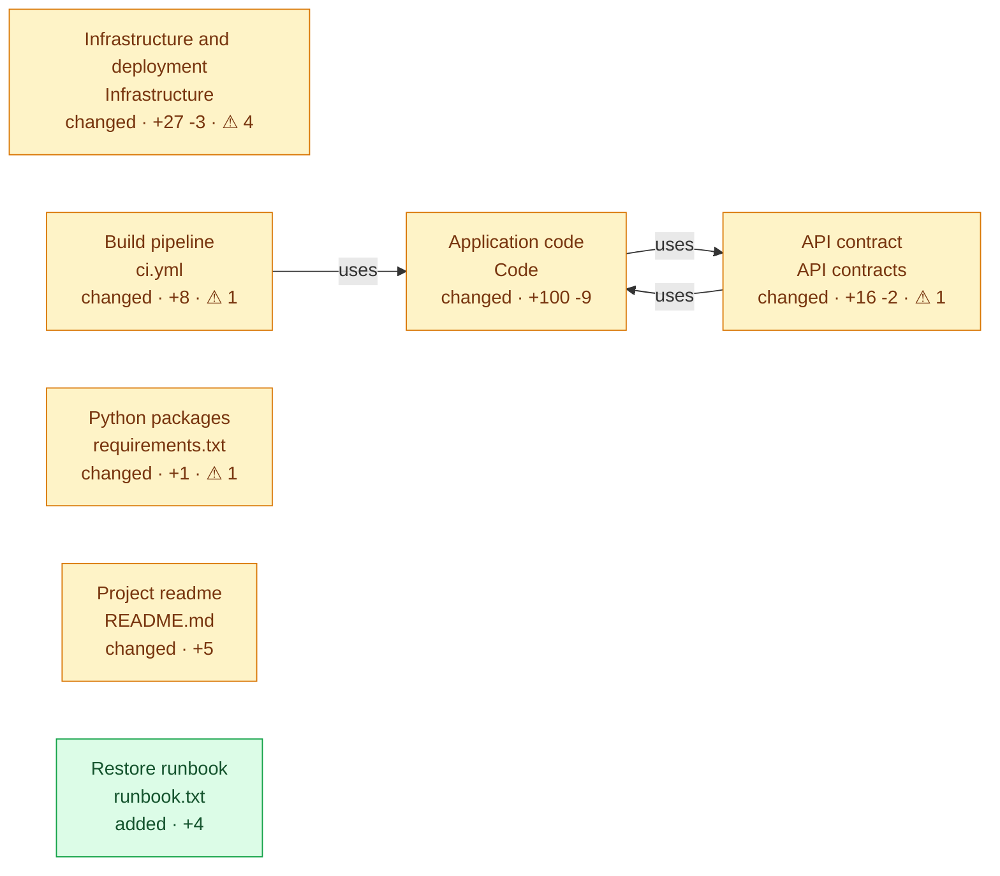

1. **Application code** (`Code`) — *changed, +100 -9* — The Python backend, Java stats service, web page and a new backup script; gains deletion, a cache and tag counts.
2. **API contract** (`API contracts`) <sub>1 file</sub> — *changed, +16 -2* ⚠ 1 — The OpenAPI description of every endpoint; adds delete and tag-count endpoints and renames one field.
3. **Infrastructure and deployment** (`Infrastructure`) <sub>4 files</sub> — *changed, +27 -3* ⚠ 4 — Container image, local compose setup, Kubernetes deployment and new cloud backup storage.
4. **Build pipeline** (`ci.yml`) <sub>GitHub Actions workflow</sub> — *changed, +8* ⚠ 1 — Runs the tests on every push; now also runs a nightly backup job.
5. **Python packages** (`requirements.txt`) <sub>Python dependencies</sub> — *changed, +1* ⚠ 1 — Third-party libraries the backend needs; adds the AWS client library.
6. **Project readme** (`README.md`) <sub>document</sub> — *changed, +5* — How to run the app; gains a section on deleting notes.
7. **Restore runbook** (`runbook.txt`) <sub>text file</sub> — *added, +4* — New step-by-step guide to restore notes from a nightly backup by pausing the API and copying the file back.

### Level 1 · Application code <sub>Code</sub>

*Three code areas changed, plus a new backup script.*

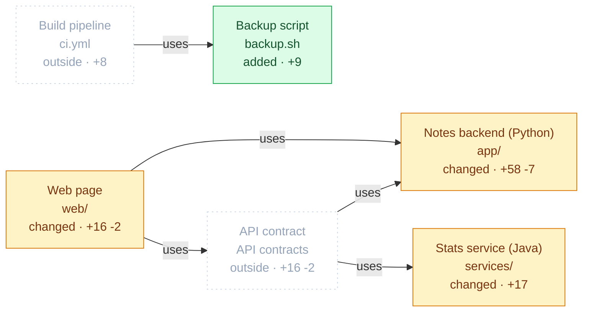

1. **Web page** (`web/`) — *changed, +16 -2* — The browser front end that lists notes; each note now has a delete button.
2. **Notes backend (Python)** (`app/`) — *changed, +58 -7* — Stores notes in a JSON file and serves them over HTTP and the command line; now cached and deletable.
3. **Backup script** (`backup.sh`) — *added, +9* — New shell script that copies the notes file to cloud storage under today's date.
4. **Stats service (Java)** (`services/`) — *changed, +17* — A separate Java service that reads notes from the API and computes statistics; now counts notes per tag.

Connected outside this view: API contract, Build pipeline

<details><summary>Level 2 · Web page</summary>


*Each note gets a delete button wired to a new API call.*

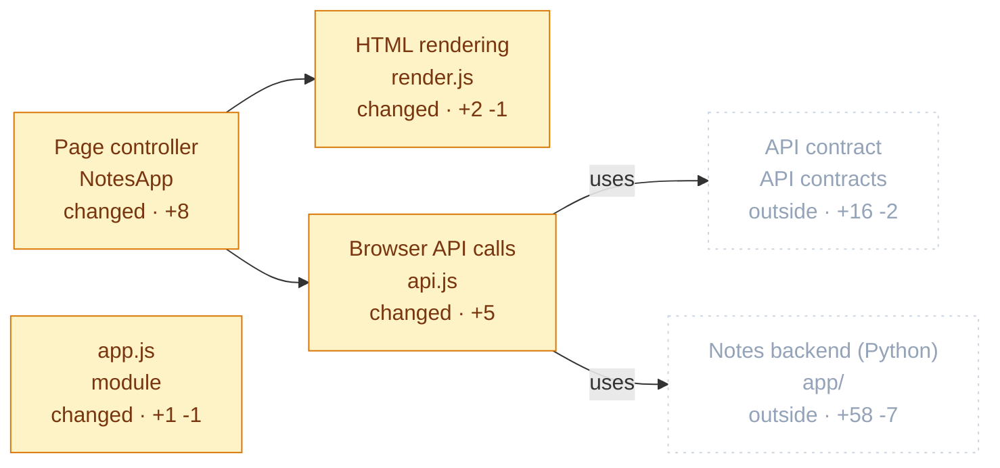

1. **Page controller** (`NotesApp`) — *changed, +8* — Loads notes and redraws the list; now reacts to delete clicks.
2. **HTML rendering** (`render.js`) — *changed, +2 -1* — Turns notes into HTML; each note now carries a delete button.
3. **Browser API calls** (`api.js`) — *changed, +5* — Functions the page uses to talk to the backend; adds a delete call.
4. **app.js** — *changed, +1 -1* — Module-level code (imports, constants, setup).

Connected outside this view: Notes backend (Python), API contract

</details>

<details><summary>Level 3 · Page controller</summary>


*Loads notes and redraws the list; now reacts to delete clicks.*

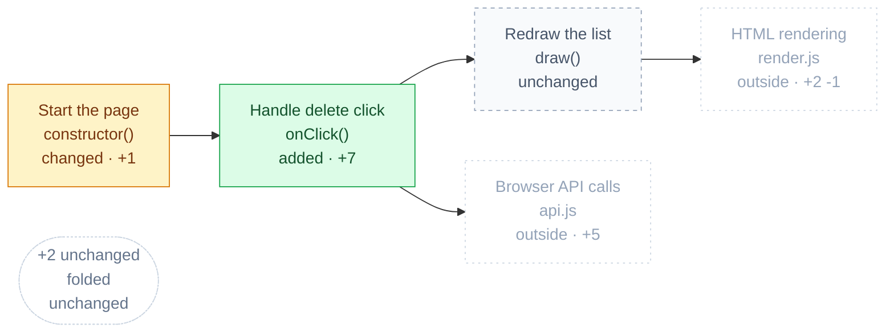

1. **Start the page** (`constructor()`) — *changed, +1* — Sets up the page and now listens for clicks on the list.
2. **Handle delete click** (`onClick()`) — *added, +7* — New: when a delete button is clicked, deletes the note and redraws.
3. **Redraw the list** (`draw()`) — *unchanged* — Renders the current notes into the page.
4. **+2 unchanged** — *unchanged* — Folded to keep this view small: start() and onSubmit().

Connected outside this view: Browser API calls, HTML rendering

</details>

<details><summary>Level 3 · HTML rendering</summary>


*Turns notes into HTML; each note now carries a delete button.*

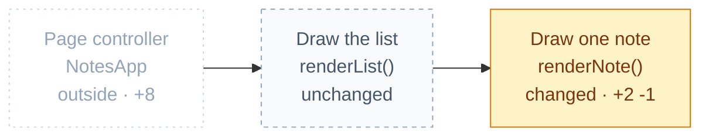

1. **Draw the list** (`renderList()`) — *unchanged* — Builds the HTML for all notes.
2. **Draw one note** (`renderNote()`) — *changed, +2 -1* — Builds a note's HTML; now with its id and a delete button.

Connected outside this view: Page controller

</details>

<details><summary>Level 3 · Browser API calls</summary>


*Functions the page uses to talk to the backend; adds a delete call.*

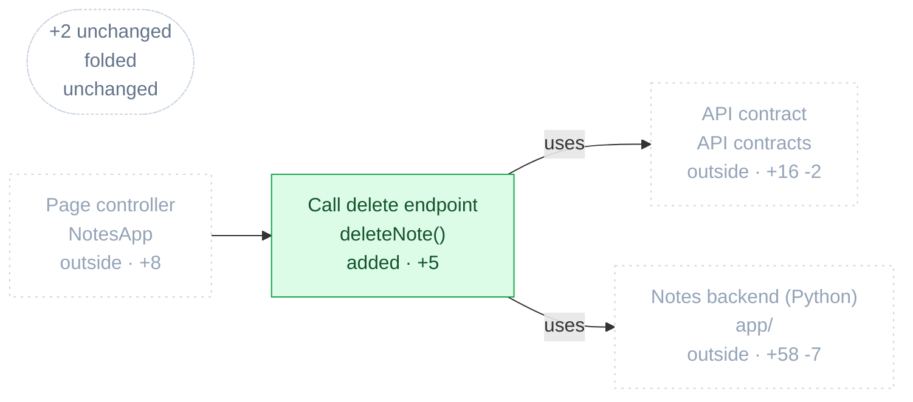

1. **Call delete endpoint** (`deleteNote()`) — *added, +5* — New: asks the backend to delete a note; true when it answers 204.
2. **+2 unchanged** — *unchanged* — Folded to keep this view small: fetchNotes() and createNote().

Connected outside this view: Notes backend (Python), API contract, Page controller

</details>

<details><summary>Level 2 · Notes backend (Python)</summary>


*Delete flows from the HTTP handler through the service to the file; reads now go through a cache.*

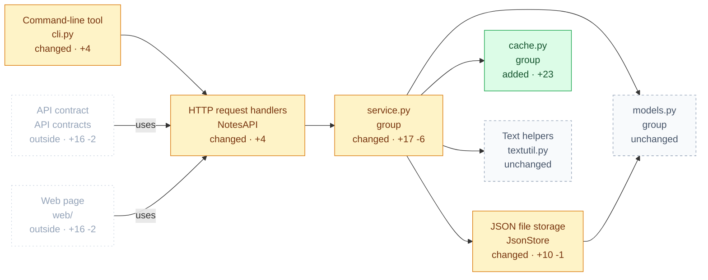

1. **Command-line tool** (`cli.py`) — *changed, +4* — Manage notes from a terminal; adds an rm command.
2. **HTTP request handlers** (`NotesAPI`) — *changed, +4* — Turns web requests into note operations; adds a handler for deleting a note.
3. **service.py** — *changed, +17 -6* — 1 files: NoteService and service.py.
4. **JSON file storage** (`JsonStore`) — *changed, +10 -1* — Reads and writes all notes in one file; can now delete one and saves via a temporary file.
5. **cache.py** — *added, +23* — 1 files: LRUCache and cache.py.
6. **models.py** — *unchanged* — 1 files: Note and models.py.
7. **Text helpers** (`textutil.py`) — *unchanged* — Makes URL-safe ids and splits text into words for search.

Connected outside this view: API contract, Web page

</details>

<details><summary>Level 3 · Command-line tool</summary>


*Manage notes from a terminal; adds an rm command.*

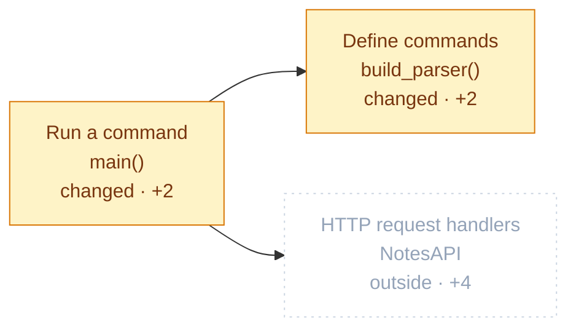

1. **Run a command** (`main()`) — *changed, +2* — Dispatches the chosen command; rm now deletes a note.
2. **Define commands** (`build_parser()`) — *changed, +2* — Declares the command-line commands; adds rm with a note id.

Connected outside this view: HTTP request handlers

</details>

<details><summary>Level 3 · HTTP request handlers</summary>


*Turns web requests into note operations; adds a handler for deleting a note.*

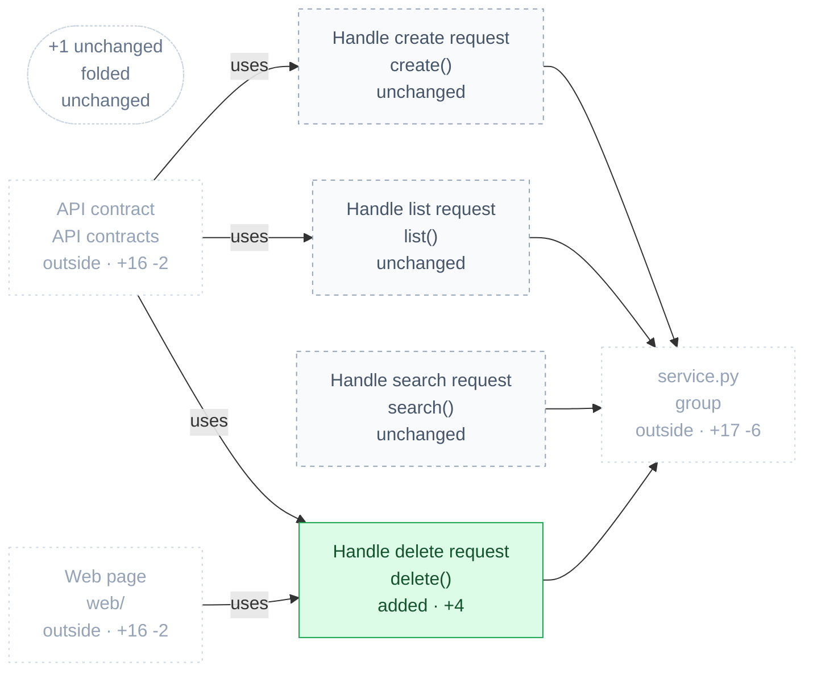

1. **Handle create request** (`create()`) — *unchanged* — Creates a note from the request body.
2. **Handle list request** (`list()`) — *unchanged* — Returns notes, optionally for one tag.
3. **Handle search request** (`search()`) — *unchanged* — Returns notes that match the search words.
4. **Handle delete request** (`delete()`) — *added, +4* — New: deletes the note and answers 204, or 404 if it did not exist.
5. **+1 unchanged** — *unchanged* — Folded to keep this view small: __init__().

Connected outside this view: service.py, API contract, Web page

</details>

<details><summary>Level 3 · service.py</summary>


*1 files: NoteService and service.py.*

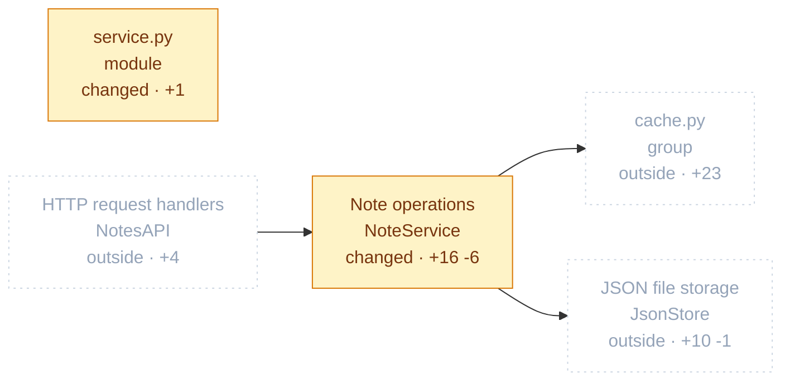

1. **Note operations** (`NoteService`) — *changed, +16 -6* — Core logic to add, list, search and now delete notes, with reads served from the cache.
2. **service.py** — *changed, +1* — Business rules for notes.

Connected outside this view: cache.py, JSON file storage, HTTP request handlers

</details>

<details><summary>Level 4 · Note operations</summary>


*Every read now goes through the cache; every write clears it.*

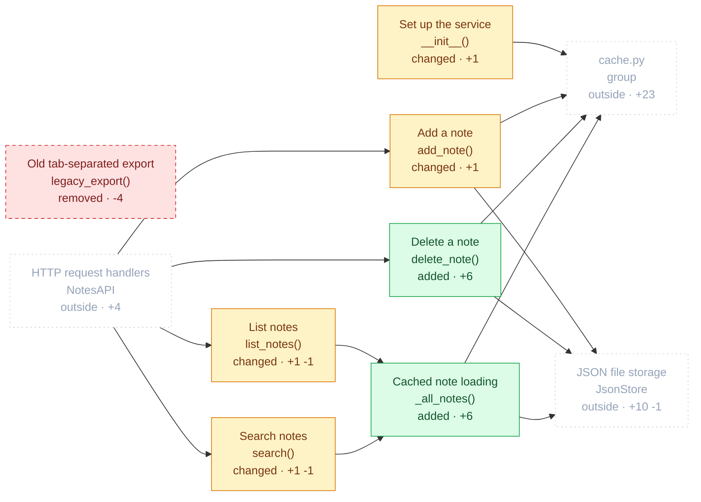

1. **Set up the service** (`__init__()`) — *changed, +1* — Connects storage and now creates a 256-entry cache.
2. **Add a note** (`add_note()`) — *changed, +1* — Saves a new note and now clears the cache so lists stay fresh.
3. **List notes** (`list_notes()`) — *changed, +1 -1* — Lists notes, now read through the cache.
4. **Search notes** (`search()`) — *changed, +1 -1* — Finds notes that share a word with the query, now read through the cache.
5. **Old tab-separated export** (`legacy_export()`) — *removed, -4* — Removed: wrote every note to a tab-separated file.
6. **Delete a note** (`delete_note()`) — *added, +6* — New: removes a note from storage and clears the cache; reports whether it existed.
7. **Cached note loading** (`_all_notes()`) — *added, +6* — New: returns all notes from the cache, reading the file only on a miss.

Connected outside this view: cache.py, JSON file storage, HTTP request handlers

</details>

<details><summary>Level 3 · JSON file storage</summary>


*Reads and writes all notes in one file; can now delete one and saves via a temporary file.*

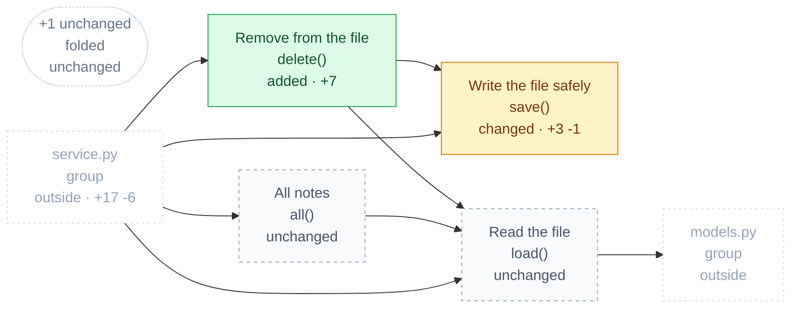

1. **Remove from the file** (`delete()`) — *added, +7* — New: deletes one note from the file; false if it was not there.
2. **Write the file safely** (`save()`) — *changed, +3 -1* — Now writes a temporary file and swaps it in, so a crash cannot corrupt the notes.
3. **All notes** (`all()`) — *unchanged* — Returns every stored note as a list.
4. **Read the file** (`load()`) — *unchanged* — Loads every note from the JSON file.
5. **+1 unchanged** — *unchanged* — Folded to keep this view small: __init__().

Connected outside this view: service.py, models.py

</details>

<details><summary>Level 3 · cache.py</summary>


*1 files: LRUCache and cache.py.*

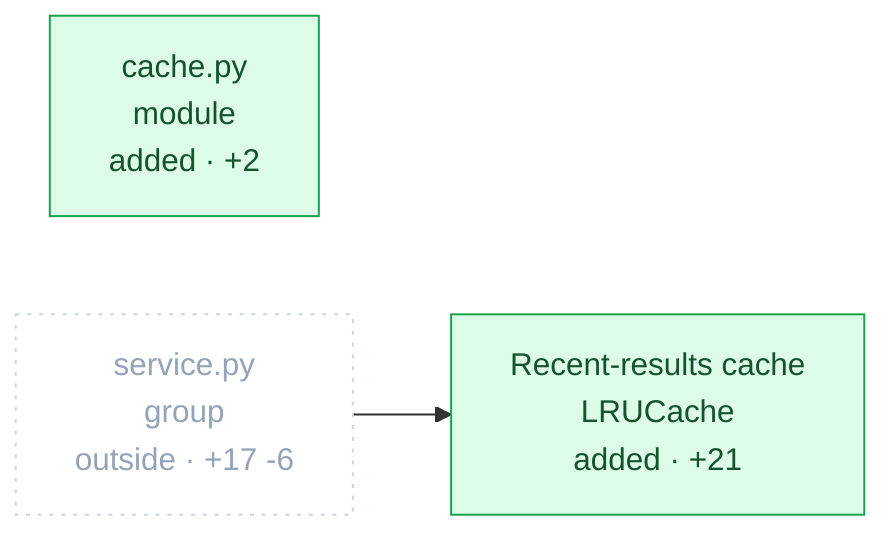

1. **Recent-results cache** (`LRUCache`) — *added, +21* — New fixed-size memory cache that forgets the least recently used entry first.
2. **cache.py** — *added, +2* — In-memory cache so repeated reads skip the disk.

Connected outside this view: service.py

</details>

<details><summary>Level 4 · Recent-results cache</summary>


*New fixed-size memory cache that forgets the least recently used entry first.*

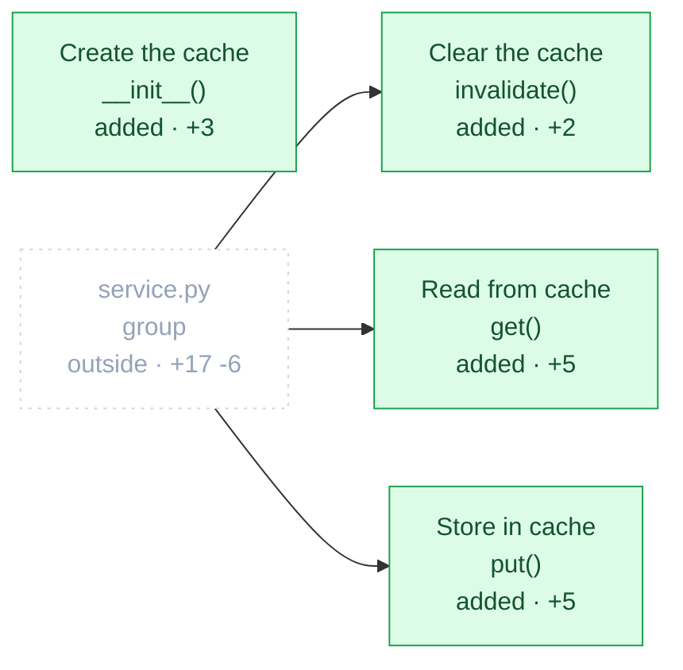

1. **Create the cache** (`__init__()`) — *added, +3* — Sets the capacity and an empty ordered store.
2. **Read from cache** (`get()`) — *added, +5* — Returns a cached value and marks it recently used; nothing if missing.
3. **Store in cache** (`put()`) — *added, +5* — Saves a value and drops the oldest one when full.
4. **Clear the cache** (`invalidate()`) — *added, +2* — Empties the cache so the next read reloads from storage.

Connected outside this view: service.py

</details>

<details><summary>Level 3 · models.py</summary>


*1 files: Note and models.py.*

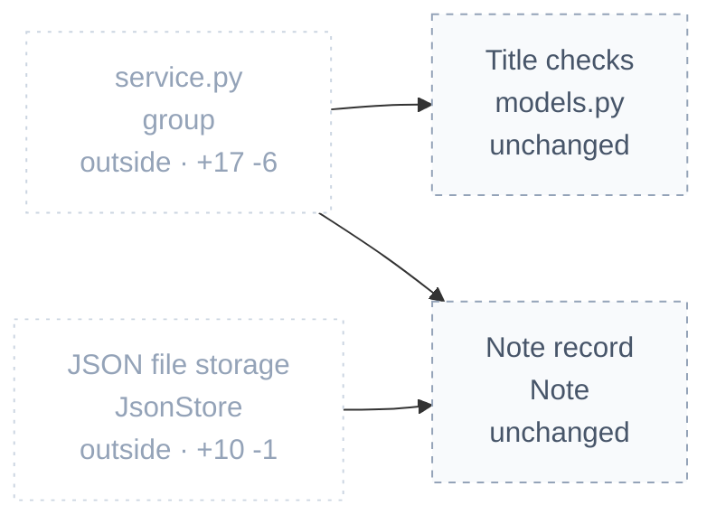

1. **Note record** (`Note`) — *unchanged* — One note: a title, a body and tags.
2. **Title checks** (`models.py`) — *unchanged* — Module-level helper that validates note titles before they are saved.

Connected outside this view: service.py, JSON file storage

</details>

<details><summary>Level 4 · Title checks</summary>


*Module-level helper that validates note titles before they are saved.*

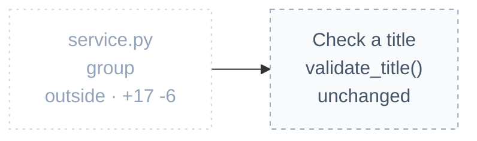

1. **Check a title** (`validate_title()`) — *unchanged* — Rejects empty titles and titles longer than 120 characters.

Connected outside this view: service.py

</details>

<details><summary>Level 3 · Text helpers</summary>


*Makes URL-safe ids and splits text into words for search.*

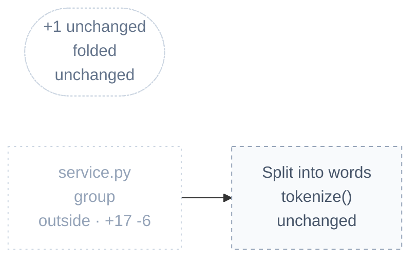

1. **Split into words** (`tokenize()`) — *unchanged* — Breaks text into lowercase words for search.
2. **+1 unchanged** — *unchanged* — Folded to keep this view small: slugify().

Connected outside this view: service.py

</details>

<details><summary>Level 2 · Backup script</summary>


*New shell script that copies the notes file to cloud storage under today's date.*

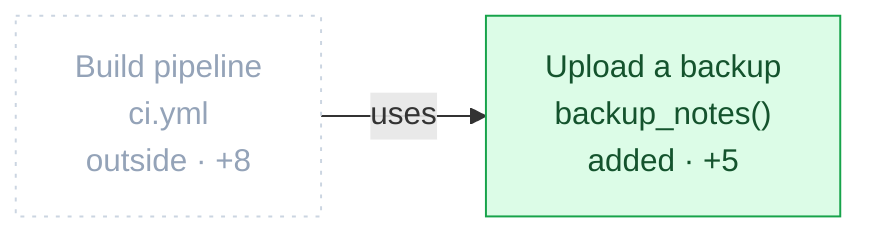

1. **Upload a backup** (`backup_notes()`) — *added, +5* — Copies the notes file to the backup bucket, named with today's date.

Connected outside this view: Build pipeline

</details>

<details><summary>Level 2 · Stats service (Java)</summary>


*The Java service gains a per-tag count behind a new endpoint.*

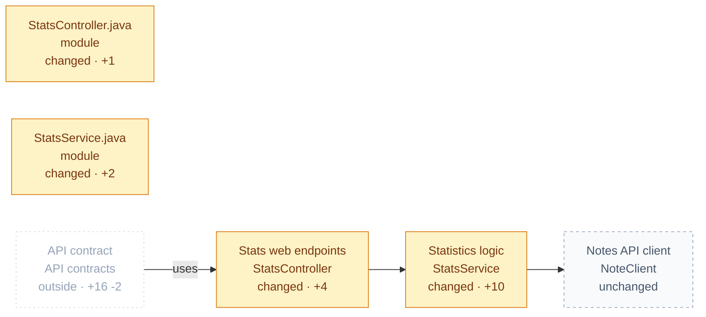

1. **Stats web endpoints** (`StatsController`) — *changed, +4* — HTTP endpoints of the stats service; adds per-tag counts.
2. **Statistics logic** (`StatsService`) — *changed, +10* — Computes numbers about notes; now counts how many notes carry each tag.
3. **Notes API client** (`NoteClient`) — *unchanged* — How the stats service fetches every note from the main API.
4. **StatsController.java** — *changed, +1* — Module-level code (imports, constants, setup).
5. **StatsService.java** — *changed, +2* — Module-level code (imports, constants, setup).

Connected outside this view: API contract

</details>

<details><summary>Level 3 · Stats web endpoints</summary>


*HTTP endpoints of the stats service; adds per-tag counts.*

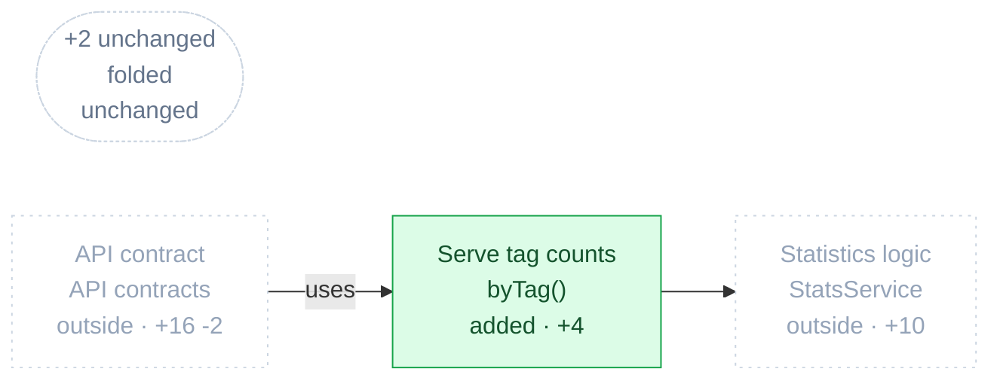

1. **Serve tag counts** (`byTag()`) — *added, +4* — New: answers the tag-counts endpoint with counts per tag.
2. **+2 unchanged** — *unchanged* — Folded to keep this view small: StatsController() and words().

Connected outside this view: API contract, Statistics logic

</details>

<details><summary>Level 3 · Statistics logic</summary>


*Computes numbers about notes; now counts how many notes carry each tag.*

```mermaid
flowchart LR
  n0["Count notes per tag<br/>countByTag()<br/>added · +10"]:::added
  n1(["+2 unchanged<br/>folded<br/>unchanged"]):::more
  n2["Stats web endpoints<br/>StatsController<br/>outside · +4"]:::ghost
  n3["Notes API client<br/>NoteClient<br/>outside"]:::ghost
  n2 --> n0
  n0 --> n3
  classDef added fill:#dcfce7,stroke:#16a34a,color:#14532d
  classDef ghost fill:#ffffff,stroke:#cbd5e1,color:#94a3b8,stroke-dasharray:2 4
  classDef more fill:#ffffff,stroke:#cbd5e1,color:#64748b,stroke-dasharray:2 2
```

1. **Count notes per tag** (`countByTag()`) — *added, +10* — New: fetches all notes and tallies how many carry each tag.
2. **+2 unchanged** — *unchanged* — Folded to keep this view small: StatsService() and wordsPerNote().

Connected outside this view: Stats web endpoints, Notes API client

</details>

<details><summary>Level 3 · Notes API client</summary>


*How the stats service fetches every note from the main API.*

```mermaid
flowchart LR
  n0["Fetch all notes<br/>fetchAll()<br/>unchanged"]:::context
  n1["Statistics logic<br/>StatsService<br/>outside · +10"]:::ghost
  n1 --> n0
  classDef context fill:#f8fafc,stroke:#94a3b8,color:#475569,stroke-dasharray:4 4
  classDef ghost fill:#ffffff,stroke:#cbd5e1,color:#94a3b8,stroke-dasharray:2 4
```

1. **Fetch all notes** (`fetchAll()`) — *unchanged* — Asks the main API for every note.

Connected outside this view: Statistics logic

</details>

### Level 1 · API contract <sub>API contracts</sub>

*The contract gains two endpoints and renames one field.*

```mermaid
flowchart LR
  n0["Endpoint list<br/>Endpoints<br/>changed · +14"]:::modified
  n1["Data shapes<br/>Schemas<br/>changed · +1 -1 · ⚠ 1"]:::modified
  n2["openapi.yaml<br/>OpenAPI contract<br/>changed · +1 -1"]:::modified
  n3["Application code<br/>Code<br/>outside · +100 -9"]:::ghost
  n0 -->|uses| n1
  n0 -->|uses| n3
  n3 -->|uses| n0
  classDef ghost fill:#ffffff,stroke:#cbd5e1,color:#94a3b8,stroke-dasharray:2 4
  classDef modified fill:#fef3c7,stroke:#d97706,color:#78350f
```

1. **Endpoint list** (`Endpoints`) <sub>API endpoints</sub> — *changed, +14* — Every HTTP operation the API promises; adds deleting a note and counting notes per tag.
2. **Data shapes** (`Schemas`) <sub>API schemas</sub> — *changed, +1 -1* ⚠ 1 — The fields a note has in API responses; the creation-date field was renamed.
3. **openapi.yaml** <sub>OpenAPI contract</sub> — *changed, +1 -1* — Module-level code (imports, constants, setup).

Connected outside this view: Application code

<details><summary>Level 2 · Endpoint list</summary>


*Every HTTP operation the API promises; adds deleting a note and counting notes per tag.*

```mermaid
flowchart LR
  n0["List notes endpoint<br/>GET /notes<br/>unchanged"]:::context
  n1["Create note endpoint<br/>POST /notes<br/>unchanged"]:::context
  n2["Delete note endpoint<br/>DELETE /notes/{id}<br/>added · +7"]:::added
  n3["Tag counts endpoint<br/>GET /stats/tags<br/>added · +5"]:::added
  n4(["+2 unchanged<br/>folded<br/>unchanged"]):::more
  n5["Application code<br/>Code<br/>outside · +100 -9"]:::ghost
  n6["Data shapes<br/>Schemas<br/>outside · +1 -1"]:::ghost
  n0 -->|uses| n6
  n0 -->|uses| n5
  n1 -->|uses| n6
  n1 -->|uses| n5
  n2 -->|uses| n5
  n3 -->|uses| n5
  n5 -->|uses| n2
  classDef added fill:#dcfce7,stroke:#16a34a,color:#14532d
  classDef context fill:#f8fafc,stroke:#94a3b8,color:#475569,stroke-dasharray:4 4
  classDef ghost fill:#ffffff,stroke:#cbd5e1,color:#94a3b8,stroke-dasharray:2 4
  classDef more fill:#ffffff,stroke:#cbd5e1,color:#64748b,stroke-dasharray:2 2
```

1. **List notes endpoint** (`GET /notes`) <sub>endpoint</sub> — *unchanged* — Returns all notes, optionally filtered by tag.
2. **Create note endpoint** (`POST /notes`) <sub>endpoint</sub> — *unchanged* — Adds a new note.
3. **Delete note endpoint** (`DELETE /notes/{id}`) <sub>endpoint</sub> — *added, +7* — New: removes a note by id; answers 204 when deleted and 404 when missing.
4. **Tag counts endpoint** (`GET /stats/tags`) <sub>endpoint</sub> — *added, +5* — New: how many notes use each tag, served by the Java stats service.
5. **+2 unchanged** — *unchanged* — Folded to keep this view small: GET /notes/search and GET /stats/words.

Connected outside this view: Application code, Data shapes

</details>

<details><summary>Level 2 · Data shapes</summary>


*The fields a note has in API responses; the creation-date field was renamed.*

```mermaid
flowchart LR
  n0["Note shape<br/>Note<br/>changed · +1 -1 · ⚠ 1"]:::modified
  n1["Endpoint list<br/>Endpoints<br/>outside · +14"]:::ghost
  n1 -->|uses| n0
  classDef ghost fill:#ffffff,stroke:#cbd5e1,color:#94a3b8,stroke-dasharray:2 4
  classDef modified fill:#fef3c7,stroke:#d97706,color:#78350f
```

1. **Note shape** (`Note`) <sub>schema</sub> — *changed, +1 -1* ⚠ 1 — Fields of a note; created was renamed createdAt, which breaks existing clients.

Connected outside this view: Endpoint list

</details>

### Level 1 · Infrastructure and deployment <sub>Infrastructure</sub>

*Packaging, local setup, the cluster and new cloud storage all changed.*

```mermaid
flowchart LR
  n0["Local multi-service setup<br/>docker-compose.yml<br/>changed · +2"]:::modified
  n1["Cloud backup storage<br/>backup.tf<br/>added · +18 · ⚠ 3"]:::added
  n2["Container image recipe<br/>Dockerfile<br/>changed · +3 -1"]:::modified
  n3["Kubernetes deployment<br/>k8s.yaml<br/>changed · +4 -2 · ⚠ 1"]:::modified
  n0 -->|uses| n2
  classDef added fill:#dcfce7,stroke:#16a34a,color:#14532d
  classDef modified fill:#fef3c7,stroke:#d97706,color:#78350f
```

1. **Local multi-service setup** (`docker-compose.yml`) <sub>Compose file</sub> — *changed, +2* — Starts the API, web page and stats service together; the API gets a cache size setting.
2. **Cloud backup storage** (`backup.tf`) <sub>Terraform</sub> — *added, +18* ⚠ 3 — New Terraform for a backup bucket and its write permission; both are far too open.
3. **Container image recipe** (`Dockerfile`) <sub>Dockerfile</sub> — *changed, +3 -1* — How the backend is packaged; moves to Python 3.13 and now runs as a non-admin user.
4. **Kubernetes deployment** (`k8s.yaml`) <sub>Kubernetes manifest</sub> — *changed, +4 -2* ⚠ 1 — How the API runs in the cluster; now three copies of version 1.5.0, but privileged.

<details><summary>Level 2 · Local multi-service setup</summary>


*Starts the API, web page and stats service together; the API gets a cache size setting.*

```mermaid
flowchart LR
  n0["Web container<br/>web<br/>unchanged"]:::context
  n1["Stats container<br/>stats<br/>unchanged"]:::context
  n2["API container<br/>api<br/>changed · +2"]:::modified
  n3["Container image recipe<br/>Dockerfile<br/>outside · +3 -1"]:::ghost
  n0 -->|uses| n2
  n1 -->|uses| n2
  n2 -->|uses| n3
  classDef context fill:#f8fafc,stroke:#94a3b8,color:#475569,stroke-dasharray:4 4
  classDef ghost fill:#ffffff,stroke:#cbd5e1,color:#94a3b8,stroke-dasharray:2 4
  classDef modified fill:#fef3c7,stroke:#d97706,color:#78350f
```

1. **Web container** (`web`) <sub>service</sub> — *unchanged* — Serves the front end with nginx.
2. **Stats container** (`stats`) <sub>service</sub> — *unchanged* — Builds and runs the Java stats service.
3. **API container** (`api`) <sub>service</sub> — *changed, +2* — Builds the backend and opens port 8000; now sets the cache size to 256.

Connected outside this view: Container image recipe

</details>

<details><summary>Level 2 · Cloud backup storage</summary>


*A public bucket and a wide-open write policy were added.*

```mermaid
flowchart LR
  n0["Backup write permission<br/>aws_iam_policy.backup_writer<br/>added · +10 · ⚠ 2"]:::added
  n1["Bucket name output<br/>output.backup_bucket<br/>added · +3"]:::added
  n2["Backup bucket<br/>aws_s3_bucket.backups<br/>added · +4 · ⚠ 1"]:::added
  n1 -->|uses| n2
  classDef added fill:#dcfce7,stroke:#16a34a,color:#14532d
```

1. **Backup write permission** (`aws_iam_policy.backup_writer`) <sub>resource</sub> — *added, +10* ⚠ 2 — New policy for the backup job; allows every storage action on every resource.
2. **Bucket name output** (`output.backup_bucket`) <sub>output</sub> — *added, +3* — Publishes the backup bucket's name for other tools.
3. **Backup bucket** (`aws_s3_bucket.backups`) <sub>resource</sub> — *added, +4* ⚠ 1 — New storage bucket for backups; set to public-read, so anyone can download the notes.

</details>

<details><summary>Level 2 · Container image recipe</summary>


*How the backend is packaged; moves to Python 3.13 and now runs as a non-admin user.*

```mermaid
flowchart LR
  n0["Image build steps<br/>container image<br/>changed · +3 -1"]:::modified
  n1["Local multi-service setup<br/>docker-compose.yml<br/>outside · +2"]:::ghost
  n1 -->|uses| n0
  classDef ghost fill:#ffffff,stroke:#cbd5e1,color:#94a3b8,stroke-dasharray:2 4
  classDef modified fill:#fef3c7,stroke:#d97706,color:#78350f
```

1. **Image build steps** (`container image`) <sub>stage</sub> — *changed, +3 -1* — Python 3.13 base, creates an app user and runs as it, then starts the app.

Connected outside this view: Local multi-service setup

</details>

<details><summary>Level 2 · Kubernetes deployment</summary>


*How the API runs in the cluster; now three copies of version 1.5.0, but privileged.*

```mermaid
flowchart LR
  n0["API network service<br/>Service/notes-api<br/>unchanged"]:::context
  n1["API deployment<br/>Deployment/notes-api<br/>changed · +4 -2 · ⚠ 1"]:::modified
  n0 -->|uses| n1
  classDef context fill:#f8fafc,stroke:#94a3b8,color:#475569,stroke-dasharray:4 4
  classDef modified fill:#fef3c7,stroke:#d97706,color:#78350f
```

1. **API network service** (`Service/notes-api`) <sub>service</sub> — *unchanged* — Exposes the API deployment on port 80 inside the cluster.
2. **API deployment** (`Deployment/notes-api`) <sub>deployment</sub> — *changed, +4 -2* ⚠ 1 — Runs the API image; now three replicas of version 1.5.0 in a privileged container.

</details>

### Level 1 · Build pipeline <sub>ci.yml</sub>

*Tests still run on every push; a nightly backup job was added.*

```mermaid
flowchart LR
  n0["Pipeline triggers<br/>on<br/>changed · +2"]:::modified
  n1["Nightly backup job<br/>backup<br/>added · +6 · ⚠ 1"]:::added
  n2["Test job<br/>test<br/>unchanged"]:::context
  n3["Application code<br/>Code<br/>outside · +100 -9"]:::ghost
  n1 -->|uses| n2
  n1 -->|uses| n3
  classDef added fill:#dcfce7,stroke:#16a34a,color:#14532d
  classDef context fill:#f8fafc,stroke:#94a3b8,color:#475569,stroke-dasharray:4 4
  classDef ghost fill:#ffffff,stroke:#cbd5e1,color:#94a3b8,stroke-dasharray:2 4
  classDef modified fill:#fef3c7,stroke:#d97706,color:#78350f
```

1. **Pipeline triggers** (`on`) <sub>trigger</sub> — *changed, +2* — Runs on every push and now also every night at 2 a.m.
2. **Nightly backup job** (`backup`) <sub>job</sub> — *added, +6* ⚠ 1 — New: runs the backup script after the tests pass; uses an unpinned checkout action.
3. **Test job** (`test`) <sub>job</sub> — *unchanged* — Checks out the code, sets up Python and runs the tests.

Connected outside this view: Application code

### Level 1 · Python packages <sub>requirements.txt</sub>

*Third-party libraries the backend needs; adds the AWS client library.*

```mermaid
flowchart LR
  n0["AWS client library<br/>boto3<br/>added · +1 · ⚠ 1"]:::added
  n1(["+1 unchanged<br/>folded<br/>unchanged"]):::more
  classDef added fill:#dcfce7,stroke:#16a34a,color:#14532d
  classDef more fill:#ffffff,stroke:#cbd5e1,color:#64748b,stroke-dasharray:2 2
```

1. **AWS client library** (`boto3`) <sub>package</sub> — *added, +1* ⚠ 1 — New dependency for talking to AWS from Python.
2. **+1 unchanged** — *unchanged* — Folded to keep this view small: requests.

### Level 1 · Project readme <sub>README.md</sub>

*How to run the app; gains a section on deleting notes.*

```mermaid
flowchart LR
  n0["Deleting notes guide<br/>Deleting notes<br/>added · +5"]:::added
  n1(["+2 unchanged<br/>folded<br/>unchanged"]):::more
  classDef added fill:#dcfce7,stroke:#16a34a,color:#14532d
  classDef more fill:#ffffff,stroke:#cbd5e1,color:#64748b,stroke-dasharray:2 2
```

1. **Deleting notes guide** (`Deleting notes`) <sub>section</sub> — *added, +5* — Explains the new delete command and that backups keep deleted notes for 30 days.
2. **+2 unchanged** — *unchanged* — Folded to keep this view small: Notes and Running.

---
Open `codemap.html` in a browser for the clickable map and the narrated walkthrough.
